# mcaligner

```{raw} html
<div style="display:flex;align-items:center;justify-content:center;gap:1.5rem;flex-wrap:wrap;margin:1rem 0 2rem">
  
  
  
</div>
```

mcaligner aligns the **words** of two parsed versions of the same text, for
example an Arabic translation of Ephesians and its Greek source. Sentences
(here verses) are paired by `sent_id`, and each word link joins a word of
text A to a word of text B, written Ugarit style: `3-5S` (sure) or `12-18P`
(probable). The links feed a bilingual lexicon: which lemmas translate which.

```text
A.conllu + B.conllu (+ silver.jsonl)
                         │
                         ▼
              rules ──▶ aligner ──▶ scorer ──▶ rules ...   (run)
                         │
                         ▼
                   pred.jsonl ──evaluate──▶ P/R/F1, AER
                         └──lexicon──▶ lemma → aligned lemmas
```

It is built on [MCParser](https://github.com/rbturnbull/mcparser): the
sentences and the links live in MCParser's corpus store, and the agents reach
them through MCParser's [MCP](https://modelcontextprotocol.io) server. The
same server works from Claude Desktop (`mcaligner mcp config`).

Main features:

- **Code before models**: rules link identical symbols, transliterated proper
  names and words whose translation is overwhelming in the existing links,
  each measured for precision.
- **Batched, compact agent tasks**: several sentence pairs per task, one
  model request when the evidence in the prompt is enough, answers as short
  lines that code checks and applies.
- **A confidence and an author for every link**; links below a threshold go
  back to the aligner.
- **Model tiers** (default `anthropic:claude-opus-5-5` for the aligner, Sonnet
  5.5 for the scorer) with per-role overrides, prompt caching, and a token and
  cost report after every run.

```{toctree}
:maxdepth: 2
:caption: Guide

quickstart
data
rules
agents
evaluation
mcp
```

```{toctree}
:maxdepth: 1
:caption: Reference

_generated/cli
api
development
```
